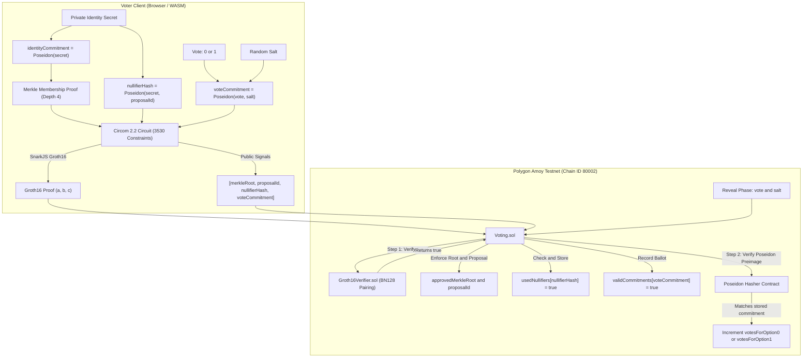

# ZK-SNARK Private DAO Voting Prototype

An educational prototype and technical demonstration of a Zero-Knowledge Private DAO Voting System designed for developers at **Pragma Mumbai**.

**Pragma Talk Positioning Statement:**
> *"Building a Private DAO Voting Prototype with Circom and Groth16: Merkle Membership, Nullifiers, and Honest Trade-offs"*

---

## 1. System Architecture



---

## 2. Cryptographic and Security Model

### A. Eligibility Model (Merkle Membership)
- Rather than accepting an unverified user-declared balance, voter eligibility is established via cryptographic inclusion in an approved **Merkle Tree**.
- Each eligible voter possesses a private scalar `identitySecret`.
- The corresponding leaf commitment is `identityCommitment = Poseidon(identitySecret)`.
- The circuit verifies that `identityCommitment` is an authorized leaf of the approved `merkleRoot`.
- **Demo Parameter**: The demo configuration uses a fixed depth of **4** ($2^4 = 16$ demo voter commitments). This parameter is intentionally sized for fast, non-blocking execution in browser WASM and Google Colab.

### B. Double-Voting Prevention (Nullifiers)
- To prevent duplicate ballots without disclosing the voter's identity leaf or wallet address, a unique nullifier is computed inside the circuit:
  $$\text{nullifierHash} = \text{Poseidon}(\text{identitySecret}, \text{proposalId})$$
- Because `proposalId` is bound to the hash, a voter can cast exactly one ballot per proposal.
- The smart contract checks `usedNullifiers[nullifierHash]`. If already recorded, the transaction reverts with `AlreadyVoted()`.
- The nullifier is **not** derived from the Ethereum wallet address, preventing address clustering.

### C. Privacy Boundary and Relayers
The ZK proof hides the approved Merkle-tree identity leaf and vote choice during the commit phase. However, a direct public-chain transaction exposes the sender address and transaction metadata. A relayer may improve sender–voter unlinkability, but privacy depends on relayer architecture, funding flow, timing analysis, network metadata, and operational assumptions.

`Voting.sol` does not record or emit `msg.sender` in voting events:
```solidity
event VoteSubmitted(uint256 indexed nullifierHash, uint256 voteCommitment);
```

### D. Commit-Reveal Tallying Model
- **Commit Phase (Voting Window)**: Voters submit `(proof, publicSignals)`. The contract verifies the proof and stores `validCommitments[voteCommitment] = true`. The ballot choice remains hidden.
- **Reveal Phase (Tallying Window)**: A voter reveals `(voteOption, salt)`. The contract calculates `Poseidon(voteOption, salt)` on-chain using an EVM Poseidon hasher contract. If the commitment exists and has not been revealed, the contract increments `votesForOption0` or `votesForOption1`.
- **Honest Limitations**:
  1. Reveal transactions are public. Vote secrecy lasts through the commit/voting phase; after a valid reveal, the selected vote option becomes publicly observable.
  2. Unrevealed commitments are not counted in the final tally.
  3. This demo does not claim homomorphic real-time tallies. Real-time private tallies without reveals require additively homomorphic encryption (e.g., Paillier, ElGamal) or MPC threshold decryption.

---

## 3. Threat Model and Non-Goals

### Threat Model
| Threat | Mitigation in This Prototype |
| :--- | :--- |
| **Ineligible Voter Injection** | Prover must provide valid Merkle path to `approvedMerkleRoot`. |
| **Double Voting** | Single-use `nullifierHash` per `proposalId` enforced in smart contract. |
| **Ballot Tampering** | Groth16 zero-knowledge proof verifies binary vote ($v \in \{0, 1\}$) and commitment binding. |
| **Front-Running Vote Choice** | Vote choices are blinded by random 256-bit salt until the reveal phase. |
| **Replay Attacks across Proposals** | `proposalId` is an explicit public signal in circuit and smart contract. |

### Non-Goals (Educational Prototype Scope)
- **Coercion Resistance**: Because a voter knows their salt and secret, they can prove their vote to a third party (receipt-freeness requires MACI or randomized encryption).
- **Sybil Resistance of Root**: Tree construction is assumed to be managed by DAO governance.
- **Off-Chain Relayer Infrastructure**: This prototype provides the decoupled smart contract interface; a production relayer network is not bundled.
- **Secure Identity Secret Management**: This educational prototype does not provide production-grade identity-secret backup, recovery, anti-phishing protection, hardware-wallet integration, or encrypted secret storage. Identity secrets must never be stored in plaintext browser localStorage in a production system.

---

## 4. Groth16 Trusted Setup Notice

This repository uses a development-only Groth16 proving setup for reproducibility. The proving key and verifier must not be reused for production deployments unless a proper multi-party trusted setup ceremony is conducted and at least one participant securely destroys their toxic waste.

The current pot12 setup supports circuits up to 2^12 constraints. The current circuit has 3,530 constraints. If the circuit grows, the Powers of Tau parameter must be upgraded.

---

## 5. Empirical Benchmark Results

On the benchmarked host, the 3,530-constraint circuit generated proofs in an average of 152.44 ms across 10 Node.js/SnarkJS WASM iterations. Browser performance may vary by device, operating system, available memory, and browser implementation.

```
GPU proving: not configured; SnarkJS WASM benchmark executed on CPU.
```

| Metric | Measured Value | Methodology / Notes |
| :--- | :--- | :--- |
| **Circuit Constraints** | **3530** | Verified via `snarkjs r1cs info circuits/build/voting.r1cs` |
| **Average Proof Generation Time** | **152.44 ms** | Min: 141.4 ms, Max: 168.0 ms (10 iterations) |
| **Average Verification Time** | **8.73 ms** | JavaScript / Alt-BN128 pairing verification |
| **Process Heap Memory** | **8.88 MB** | Peak Node.js process heap allocation |
| **Resident Set Size (RSS)** | **544.59 MB** | Process memory resident in RAM |

> **Hardware Feasibility Note**:
> The benchmarked Node.js process used approximately 8.88 MB JavaScript heap and 544.59 MB resident memory (RSS). This is within the practical limits of an 8GB RAM development laptop, although browser memory use and performance may vary.

---

## 6. Repository Structure

```
zk-private-voting/
├── circuits/
│   ├── voting.circom            # Circom 2.2 circuit (Merkle membership + nullifiers)
│   ├── input.json               # Valid inputs for witness generation (Leaf #0)
│   └── build/                   # Compiled R1CS, WASM, zkey, verification key
├── contracts/
│   ├── IPoseidon.sol            # On-chain Poseidon(2) interface
│   ├── IVerifier.sol            # Groth16 Verifier interface (uint256[4] input)
│   ├── Verifier.sol             # Generated Groth16 Alt-BN128 verifier contract
│   ├── Voting.sol               # Core voting contract with commit-reveal and nullifiers
│   └── test/
│       ├── MockVerifier.sol     # Unit test mock verifier
│       └── Voting.test.js       # 14 unit & real Groth16 integration tests
├── scripts/
│   ├── merkleTree.js            # 16-leaf Poseidon Merkle tree helper
│   ├── compileCircuit.js        # Compiles Circom to R1CS, WASM, and SYM
│   ├── setupGroth16.js          # Powers of Tau ceremony (pot12) and zkey export
│   ├── generateProof.js         # Generates proof and exports Solidity calldata
│   ├── benchmark.js             # 10-iteration empirical benchmark runner
│   └── deploy.js                # Deploys Verifier, Poseidon, and Voting to Polygon Amoy
├── frontend/
│   ├── src/
│   │   ├── components/          # Navbar, VotingInterface, ProofGenerator
│   │   ├── hooks/               # useProof (WASM Groth16), useVoting (Wagmi v2)
│   │   ├── config/              # wagmi.js (Amoy), contracts.js, merkle.js
│   │   └── pages/               # Vote, Results, Benchmark
│   └── public/circuits/         # Static voting.wasm and voting_final.zkey
├── colab/
│   └── ZK_Private_Voting_Colab.ipynb # Google Colab reproducible notebook
├── hardhat.config.js            # Polygon Amoy & Local network configuration
├── AUDIT_REPORT.md              # Complete security audit and discrepancy report
├── benchmark_results.json       # Machine-readable empirical benchmark data
├── benchmark_results.md         # Markdown benchmark report
└── package.json                 # Project dependencies and npm scripts
```

---

## 7. Local Setup and Validation Commands

### Prerequisites
- Node.js v18+ or v20+
- Native Circom binary (`circom --version` v2.1+) or root `./circom.exe`

### 1. Install Dependencies
```bash
npm ci
```

### 2. Compile Solidity Smart Contracts
```bash
npx hardhat compile
```
*Expected output: `Compiled 5 Solidity files successfully (evm target: paris).`*

### 3. Run Unit and Integration Tests
```bash
npx hardhat test
```
*Expected output:*
```
  ZK Private Voting System (Educational Prototype)
    Contract Deployment & Setup
      √ Should correctly set verifier, poseidon, approved root, and proposalId
      √ Should initialize with zero votes
      √ Should revert if deployed with zero addresses or zero root
    Ballot Submission Verification
      √ Should submit a valid vote and emit VoteSubmitted without voter address
      √ Should reject vote with wrong Merkle root
      √ Should reject vote with wrong proposal ID
      √ Should reject vote with zero nullifier or zero commitment
      √ Should prevent double voting with the same nullifier
      √ Should reject vote when Verifier returns false (InvalidProof)
    Tally and Reveal Mechanics
      √ Should reveal and increment tallies correctly using on-chain Poseidon
      √ Should reject reveal with incorrect salt or vote choice
      √ Should reject invalid vote option (> 1)
      √ Should prevent revealing the same commitment twice
    Real Groth16 End-to-End Integration
      √ Should successfully verify a genuine SnarkJS Groth16 proof with Groth16Verifier.sol

  14 passing (2s)
```

### 4. Compile the Circom Circuit
```bash
node scripts/compileCircuit.js
```

### 5. Check Circuit Constraints
```bash
snarkjs r1cs info circuits/build/voting.r1cs
```
*Expected output:*
```
[INFO]  snarkJS: Curve: bn-128
[INFO]  snarkJS: # of Wires: 3538
[INFO]  snarkJS: # of Constraints: 3530
[INFO]  snarkJS: # of Private Inputs: 13
[INFO]  snarkJS: # of Public Inputs: 0
[INFO]  snarkJS: # of Labels: 5214
[INFO]  snarkJS: # of Outputs: 4
```

### 6. Run Development Trusted Setup
```bash
node scripts/setupGroth16.js
```

### 7. Generate a Valid Proof
```bash
node scripts/generateProof.js
```

### 8. Verify Proof Locally
```bash
snarkjs groth16 verify circuits/build/verification_key.json scripts/generated/public.json scripts/generated/proof.json
```
*Expected output: `[INFO] snarkJS: OK!`*

### 9. Run Empirical Benchmark
```bash
node scripts/benchmark.js
```

### 10. Build the Frontend
```bash
cd frontend && npm ci && npm run build
```

---

## 8. Network Configuration: Polygon Amoy

This project is configured exclusively for **Polygon Amoy Testnet** (Sepolia-anchored).

- **Network Name**: Polygon Amoy Testnet
- **Chain ID**: `80002`
- **Currency**: POL
- **Public RPC**: `https://rpc-amoy.polygon.technology` (or via `AMOY_RPC_URL`)
- **Block Explorer**: `https://amoy.polygonscan.com`
- **Testnet Faucet**: `https://faucet.polygon.technology`

### Deployment to Amoy
1. Configure `.env`:
   ```bash
   cp .env.example .env
   ```
2. Populate `PRIVATE_KEY` and `POLYGONSCAN_API_KEY`.
3. Deploy:
   ```bash
   npx hardhat run scripts/deploy.js --network amoy
   ```

---

## 9. Pragma Mumbai Demo Checklist

When demonstrating this project live at Pragma Mumbai:

1. **Clone & Setup**:
   ```bash
   git clone https://github.com/samudragupto/zk-private-voting.git
   cd zk-private-voting && npm ci
   ```
2. **Execute Full Pipeline or Open Google Colab**:
   Open `colab/ZK_Private_Voting_Colab.ipynb` and run cells top-to-bottom.
3. **Inspect Circuit & Constraints**:
   Run `snarkjs r1cs info circuits/build/voting.r1cs` to prove **3530 real constraints**.
4. **Run On-Chain Tests**:
   Run `npx hardhat test` to demonstrate the 14 passing unit and Groth16 integration tests.
5. **Demonstrate Proof Generation**:
   Run `node scripts/generateProof.js` to show proof generation in ~150ms on the host.
6. **Deploy to Amoy or Local Node**:
   Run `npx hardhat run scripts/deploy.js` to deploy `Verifier.sol`, `Poseidon(2)`, and `Voting.sol`.
7. **Cast & Reveal**:
   - In frontend or script, cast ballot with proof. Show `VoteSubmitted` event containing no wallet address.
   - Reveal with `(vote, salt)`. Show `VoteRevealed` event and incremented tally.
8. **Explain the Trade-offs**:
   Conclude with the honest privacy boundary: transaction sender privacy requires a relayer.

---

## What This Prototype Demonstrates
- Merkle-tree-based eligibility instead of unverified token-balance inputs.
- Secret-derived, proposal-specific nullifiers for double-voting prevention.
- Groth16 proof generation and verification with Circom and SnarkJS.
- Solidity integration with a generated Groth16 verifier.
- Commit–reveal vote tallying with explicit privacy limitations.
- Empirical CPU/WASM benchmarks without fabricated GPU claims.
- A reproducible Google Colab and local development workflow.

## What This Prototype Does Not Solve
- Sender metadata privacy without a relayer.
- Coercion resistance or receipt-freeness.
- Production-grade trusted setup.
- Homomorphic or threshold-encrypted private tallying.
- Secure identity-secret management.
- DAO governance or Sybil-resistance policy for Merkle-root construction.

---

## License

Distributed under the MIT License. See [LICENSE](LICENSE) for details.
